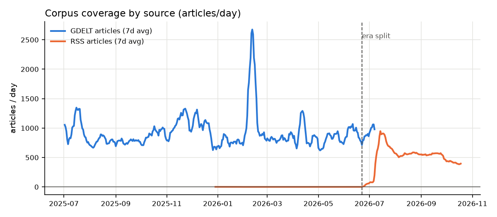
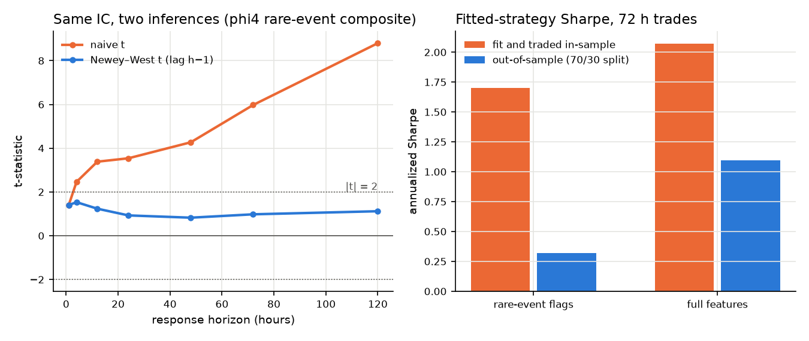
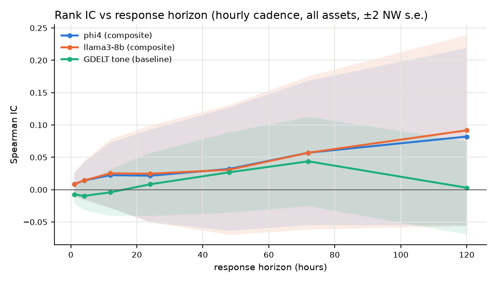
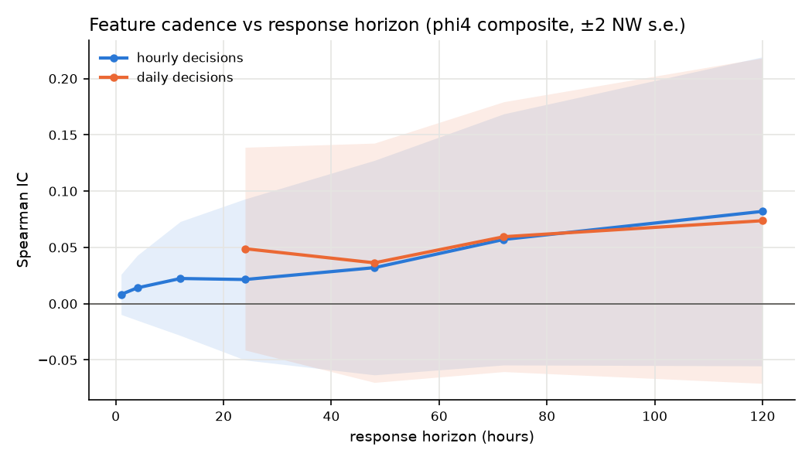
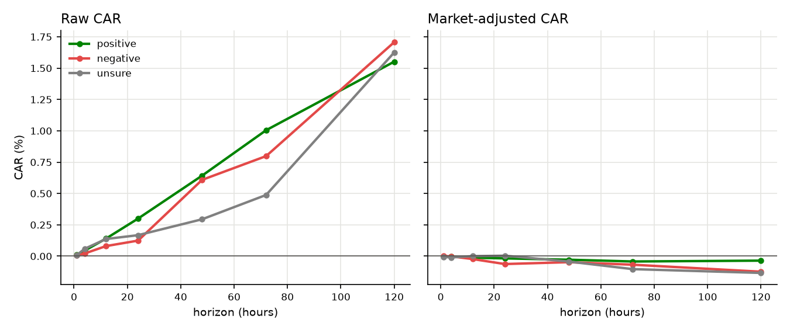

# Do Small Local LLMs Extract Alpha from Crypto News? An IC-Based Study — v2

**AlphaSent research note — 2026-10-19.** Supersedes [v1](WHITEPAPER.md) (2026-07-29). Same code, same models, same prompt; a corpus 3.2× larger, a price history extended by three months, and both models re-extracted over it.

---

## Abstract

We ask whether a small, locally run LLM reading crypto news produces features that rank future returns. The measure is the information coefficient (IC): the rank correlation between a feature observed at hour t and the asset's return from t to t + h, on five Binance perpetuals (BTC, ETH, BNB, SOL, XRP), with t-statistics corrected for the overlap between adjacent multi-hour returns (Newey–West). v1 found no significant signal, found that the LLM's directional sentiment ("polarity") failed everywhere, and found that a free non-LLM tone score did better than either model. This version reruns the identical pipeline, with both models, on 60,442 RSS items instead of 18,580, roughly 17 weeks of dense news text instead of 5, and prices to 2026-10-18.

The headline cell moved. phi-4's composite feature at h = 120 h went from IC +0.016 to **+0.082** (t 1.20, n = 6,919 hourly timestamps). Read naively, the signal appeared once there was enough data. It did not. The full sample is the union of regimes that differ in both news density and mean return: before RSS ingestion began (the "GDELT era") the composite averages −0.33 and the mean 120 h forward return is −1.22 %; in the RSS era the composite averages +0.65 and the return +1.58 %. A pooled correlation absorbs that coincidence. Rank and standardise feature and return inside each regime, then pool, and the same cell goes from +0.087 to **−0.034**. Inside each of the three regimes — GDELT era, RSS before v1's cut-off, RSS after it — the correlation is −0.027, −0.158 and −0.031. The part of the pooled number that grew is a comparison of three group means. Two checks corroborate it. Llama-3's July features, held fixed, nearly doubled their pooled IC (+0.031 → +0.059) from the price extension alone. And Llama-3 re-extracted over the full corpus reproduces the pattern with a different model: pooled +0.092 at 120 h (t 1.24, n 6,919), within-regime −0.040.

What survives from v1: no LLM feature reaches |t| = 2 on the full period (0 of 264 cells); polarity is zero-to-negative inside every regime; the naive t-statistic at 120 h reads 8.80 where the overlap-corrected one reads 1.12. v1's one directional lead — negative news followed by −0.75 % market-adjusted return over five days — shrinks to −0.12 % on three times the events and is now no different from the neutral placebo bucket; it is overturned. The GDELT tone score remains the bar in a narrower sense than v1 claimed: its value inside the GDELT era (+0.075 at 72 h, t 2.05, n = 4,200) is the only IC in the study that is both measured within one regime and positive at t ≈ 2, and it is one cell of a 674-cell grid. For phi-4, the typed event flags are the only feature family whose within-regime values are not negative (regulation +0.002, depeg +0.017 at 120 h). For Llama-3 every flag is negative within regime (regulation −0.053, depeg −0.082). The flags remain the only place worth further work, but no lead that depends on which model reads the article counts as a finding. v1's model-choice result holds on matched windows: the two models disagree on what they extract (event-type distance 0.43) yet their IC profiles correlate at 0.80 across 77 feature-horizon cells.

---

## 1. System overview

Unchanged from v1. The pipeline (see [README](../README.md)) runs in four layers:

1. **Raw ingest** — GDELT + RSS feeds.
2. **LLM extraction ETL** — offline, cached by content hash × model version × prompt version.
3. **Point-in-time-safe feature store** — only articles published before a bar's open contribute to that bar's features, so no future information reaches a past decision.
4. **Evaluation** — IC computation.

A monthly perpetual-swap perimeter file gates which articles reach the LLM, so the tradable universe matches what was listed at the time, and supplies the asset label directly. One defect in how that gate was applied was fixed during the refresh (§4c(b)).

The LLM emits one `EventRecord` per article: asset, event type (hack, regulation, listing, depeg, macro, partnership, fork, other, …), polarity ∈ [−1, 1], magnitude, novelty, confidence, and a self-reported `extraction_only` flag indicating whether it relied solely on the article text.

## 2. Data

| Source | v1 (corpus to 2026-07-28) | v2 (corpus to 2026-10-18) | Role |
|---|---|---|---|
| GDELT GKG | 339,963 articles, 2025-07-02 → 2026-07-07 | unchanged | historical metadata + document tone; no text |
| RSS (17 feeds, one since dropped) | 18,580 items, 54 dated partitions, dense from 2026-06-22 | **60,442** items, 135 partitions, to 2026-10-18 | live text corpus |
| Binance OHLCV, hourly | 4,825 bars/symbol, to 2026-07-18 | 7,039 bars/symbol, to 2026-10-18 06:00 UTC | targets |
| phi-4 extractions | 3,454 records | **21,939** records, to 2026-10-18 17:34 | LLM events |
| Llama-3 extractions | 3,758 records | **22,547** records, to 2026-10-18 21:13 | LLM events |

Sources: `data/results{,_baseline_20260729}/corpus_timeline.csv`, `data/cache/extractions/`. v1's table printed 18,498 RSS items; its own `corpus_timeline.csv` gives 18,580. The phi-4 pass ran on 2026-10-18 against 60,382 RSS items; the Llama-3 pass ran that night (18,842 new items, 0 hard failures) against 60,442. The extra items and the 4-hour difference in end dates fall after the last price bar, so they have no forward return and enter no IC.

v1 §2 said that **97 % of all LLM events fall inside a four-week window**. That is now false: 112 of 21,939 phi-4 records (0.5 %) predate the RSS era (Llama-3: 140 of 22,547, 0.6 %), and the rest spread over 2026-06-22 → 2026-10-18, about 17 weeks. The underlying point of v1 §2 stands: GDELT supplies no text, so its year of history still contributes almost nothing to the LLM features and only supports the tone baseline (§7). The one exception is small: 14 GDELT records carry a URL as their "title", and a ticker inside the URL can match. The v2 split of events by source (v1's RSS / GDELT-body columns) was not tabulated.

In effective sample terms, the dense-text window went from ~5 to ~17 weeks, which at a 5-day horizon is roughly 7 → 24 independent observations per asset. The cross-section is still five assets.

## 3. Methodology

### 3.1 Why IC, not Sharpe

Unchanged. Sharpe measures a complete strategy — sizing, volatility targeting, the fitted model. The object here is raw predictive power, which IC isolates:

IC(h) = corr( feature[t], close[t+h] / close[t] − 1 ),

reported as Pearson and Spearman (rank) correlation. Rank IC is insensitive to crypto's fat tails and comparable across feature sets. With 2 models × 2 cadences × 11 features × 7 horizons × 3 periods, unadjusted Sharpe ratios on this grid would be uninterpretable.

### 3.2 Overlap-robust inference

This is the part of v1 that held up, and it is why the 8.80 below should not be believed.

An h-hour forward return sampled every hour overlaps its neighbour by h − 1 hours, and the news features are 24 h rolling windows recomputed hourly. Adjacent observations are therefore strongly correlated, and the naive t-statistic overstates the evidence by roughly √h. Write the IC as the mean of per-timestamp products z_t (standardised feature × standardised forward return; their mean is the correlation) and use the Newey–West estimator, which replaces the variance of z̄ with a weighted sum of its autocovariances:

t = z̄ / √(S/T),  S = γ̂₀ + 2 Σ_{l=1}^{L} (1 − l/(L+1)) γ̂_l,  L = h − 1 bars.

On simulated null data with 24 h overlapping returns and a persistent feature, the naive t reads 3.28 and the Newey–West t 0.95 (self-check in `scripts/ic_study.py`; simulation, unchanged since v1).

Refreshed on real data, phi-4's rare-event composite (sum of the four event-type flags), hourly, full period (`data/logs/refresh_study_20261018.log`):

| h (hours) | 1 | 4 | 12 | 24 | 48 | 72 | 120 |
|---|---|---|---|---|---|---|---|
| naive t | 1.40 | 2.46 | 3.38 | 3.54 | 4.27 | 5.97 | **8.80** |
| Newey–West t | 1.40 | 1.53 | 1.24 | 0.93 | 0.82 | 0.98 | **1.12** |
| v1 naive / NW at 120 h | | | | | | | 9.7 / 1.45 |

The strategy-level version of the same mistake (right panel): a Ridge model predicting 72 h returns, trading each asset on its own prediction at non-overlapping 72 h intervals.

| Feature set | v1 in-sample / out-of-sample Sharpe | v2 in-sample / out-of-sample Sharpe |
|---|---|---|
| all single features | ≈ 1.5 / ≤ 0 | 2.07 / 1.09 |
| rare-event flags | not reported / 0 (no events in the training window, nothing traded) | 1.70 / 0.32 |

The out-of-sample Sharpe is now positive, which v1 did not see. It is not validation. The hold-out is the last 30 % of each asset's rows, roughly the last 12 weeks, so it sits inside the post-July regime (§4b). Positions are the prediction z-scored over the hold-out window itself, so they average zero over that window: the 1.09 is a timing result inside one regime, not the regime's mean return, and it agrees with the one positive per-regime value in §4b (+0.040 at 72 h in the new data). Two caveats bound it. The z-scoring uses the hold-out's own mean and standard deviation, a mild look-ahead. And 12 weeks of non-overlapping 72 h trades is about 29 trades per asset, for which the standard error of an annualised Sharpe is about 2 under an i.i.d. approximation (√(121.7 trades per year / 29)). A Sharpe of 1.09 is inside one standard error of zero.

Three aggregation scopes are reported, as in v1: per-asset time-series IC (`ts_asset`), the cross-asset mean of per-timestamp products (`ts_all`, the headline), and per-timestamp cross-sectional IC (`cs_pooled`, still computed on N = 5 assets and still noisy).

### 3.3 Event study with a placebo bucket

Unchanged. High-conviction feature bars (high-confidence events present, |polarity_sum| ≥ 0.4) are bucketed by `polarity_mean` into **positive**, **negative** and **unsure**; the unsure bucket is a placebo that drifts with the market if the directional buckets merely time market-wide moves. Cumulative abnormal returns (CAR: the summed return over the window) are reported raw and market-adjusted (minus the equal-weight return of the five assets over the same window). No standard errors are computed for the CARs.

All results are persisted in `data/results/ic_grid.csv` (v1 vintage: `data/results_baseline_20260729/ic_grid.csv`). The grid's eras are fixed in `scripts/ic_study.py` (`ERA_SPLIT = 2026-06-22`, the start of RSS ingestion): `gdelt_era` before it, `rss_era` after, `full` the union. They were set in v1, not chosen for v2.

## 4. Results: IC across horizons and implementation options

phi-4 rank IC, `ts_all`, hourly cadence, full period, v1 → v2, with the v2 Newey–West t in brackets (`ic_grid.csv`, both vintages; n = 6,919–7,038 hourly timestamps per v2 cell, 4,705–4,824 in v1):

| Feature | 1 h | 4 h | 12 h | 24 h | 48 h | 72 h | 120 h |
|---|---|---|---|---|---|---|---|
| composite_full | +0.000→+0.008 [0.92] | −0.006→+0.014 [0.98] | −0.004→+0.022 [0.88] | −0.020→+0.022 [0.60] | −0.016→+0.032 [0.67] | +0.004→+0.057 [1.02] | +0.016→**+0.082** [1.20] |
| composite_rare | +0.005→+0.011 [1.40] | +0.009→+0.020 [1.53] | +0.019→+0.028 [1.24] | +0.006→+0.029 [0.93] | +0.010→+0.035 [0.82] | +0.041→+0.048 [0.98] | +0.065→+0.069 [1.12] |
| polarity_sum | −0.001→+0.006 [0.71] | −0.010→+0.007 [0.56] | −0.004→+0.012 [0.54] | −0.017→+0.016 [0.49] | −0.025→+0.018 [0.44] | −0.016→+0.046 [0.94] | −0.016→+0.061 [1.04] |
| mag_weighted_polarity | −0.001→+0.007 [0.85] | −0.008→+0.008 [0.64] | −0.009→+0.010 [0.46] | −0.024→+0.010 [0.31] | −0.036→+0.013 [0.32] | −0.030→+0.040 [0.84] | −0.030→+0.052 [0.89] |
| regulation_flag | +0.007→+0.012 [1.70] | +0.010→+0.021 [1.75] | +0.012→+0.028 [1.37] | −0.000→+0.022 [0.76] | +0.004→+0.021 [0.54] | +0.032→+0.051 [1.15] | +0.054→+0.078 [1.45] |
| depeg_flag | +0.001→+0.006 [1.03] | +0.007→+0.018 [1.89] | +0.021→+0.031 [1.87] | +0.018→+0.034 [1.53] | +0.013→+0.030 [1.39] | +0.022→+0.031 [1.29] | +0.037→+0.036 [1.28] |
| hack_flag | +0.004→+0.005 [0.86] | +0.009→+0.007 [0.73] | +0.023→+0.008 [0.53] | +0.013→+0.012 [0.62] | +0.014→+0.027 [1.10] | +0.023→+0.046 [1.50] | +0.038→+0.040 [1.11] |
| listing_flag | +0.003→+0.002 [0.24] | +0.003→−0.002 [−0.15] | +0.007→+0.002 [0.10] | +0.013→+0.007 [0.28] | +0.031→+0.007 [0.21] | +0.031→−0.010 [−0.27] | +0.026→−0.009 [−0.21] |
| GDELT tone_sum_24h | −0.005 [−0.64] | −0.005 [−0.46] | +0.006 [0.29] | +0.020 [0.76] | +0.047 [1.45] | **+0.068 [1.95]** | +0.023 [0.63] |

*(Composites are equal-weight sums of z-scored features; rare-event = sum of the hack, depeg, listing and regulation flags. Tone is identical in both vintages, n = 4,599.)*

The strongest full-period cells, ranked by |t|:

| Model | Feature | Cadence | Horizon | IC | t (NW) | n |
|---|---|---|---|---|---|---|
| GDELT tone | tone_sum_24h | 1 h | 72 h | 0.068 | 1.95 | 4,599 |
| GDELT tone | tone_sum_24h | 1 d | 72 h | 0.083 | 1.92 | 193 |
| phi-4 | depeg_flag | 1 h | 4 h | 0.018 | 1.89 | 7,035 |
| phi-4 | depeg_flag | 1 h | 12 h | 0.031 | 1.87 | 7,027 |
| phi-4 | hack_flag | 1 d | 48 h | 0.063 | 1.83 | 292 |
| phi-4 | regulation_flag | 1 h | 4 h | 0.021 | 1.75 | 7,035 |

The best Llama-3 full-period cell is `mag_weighted_polarity` at 120 h (+0.097, t 1.46, n 6,919).

**No full-period cell reaches |t| ≥ 2** (0 of 264 `ts_all` rank-IC cells, as in v1). v1's sentence "no cell reaches |t| ≥ 2" was true of the full period only: the era sub-periods had 3 such cells in v1 and have 12 in v2 (2 in the GDELT era, 10 in the RSS era, out of 674 era-plus-full cells). In the RSS era all ten are negative: phi-4 `listing_flag` at 120 h (−0.129, t −2.15, n 2,719) and on daily cadence at 72 h and 120 h; phi-4 `polarity_mean` at 12 h (−0.066, t −2.11, n 2,827); Llama-3 `listing_flag` at 72 h and 120 h (−0.125, t −2.41, n 2,719) and on daily cadence at 72 h; Llama-3 `regulation_flag` at 24 h and 48 h (−0.090, t −2.22, n 2,791); and tone at 12 h (−0.113, t −2.00, n 399). With 674 correlated tests, a handful of |t| > 2 cells is what chance produces; none was pre-registered.

Most of the table moves up together, from negative or flat to positive. Two exceptions: `hack_flag` falls at 1–12 h (0.023 → 0.008 at 12 h) and `listing_flag` falls at every horizon. That broad lockstep rise is the pattern §4b explains.

## 4b. Regime contrast: why the headline number moved

### The arithmetic

Suppose the sample consists of two regimes. In regime A the feature is usually low and returns are usually low; in regime B the feature is usually high and returns are usually high. Inside each regime, the feature may have no relation to returns at all. Pool the two and compute one correlation: the pooled covariance is the average within-regime covariance plus the covariance of the regime means (the law of total covariance, Cov(X, Y) = E[Cov(X, Y | g)] + Cov(E[X | g], E[Y | g])). The second term is positive whenever the regime with more feature also has more return, regardless of what happens inside either regime. This is Simpson's paradox, and its signature is a pooled correlation that lies outside the range of the correlations of the parts.

That is what the grid shows. phi-4 `composite_full`, rank IC at 120 h, hourly (`ic_grid.csv`):

| Period | IC | t (NW) | n |
|---|---|---|---|
| gdelt_era (2025-12-29 → 2026-06-21) | −0.024 | −0.46 | 4,200 |
| rss_era (2026-06-22 → 2026-10-13) | −0.075 | −0.92 | 2,719 |
| full (union of the two) | **+0.082** | 1.20 | 6,919 |

A correlation of +0.082 over a sample whose two halves read −0.024 and −0.075 is not a property of either half. The regime means (`scripts/era_decomposition.py`, phi-4, hourly decisions, h = 120; the n here is the row count of the sparsest asset, hence smaller than the grid's):

| Regime | n | mean composite_full | mean 120 h forward return | rank IC inside regime |
|---|---|---|---|---|
| GDELT era | 3,816 | −0.33 | −1.22 % | −0.027 |
| RSS, up to v1's cut-off (2026-06-22 → 07-27) | 624 | +0.39 | +0.69 % | −0.158 |
| RSS, new data (2026-07-28 →) | 1,855 | +0.76 | +1.99 % | −0.031 |

News is dense exactly where returns were positive. In the GDELT era the LLM had almost no text (112 records), so its features sit near their floor; in the RSS era they are active; and the RSS era, especially the three months added by the refresh, had the highest mean forward returns in the sample.

### The within-regime estimate

The diagnostic removes the between-regime term directly: inside each regime, feature and forward return are ranked and standardised by that regime's own mean and standard deviation; the regimes are then pooled and correlated per asset, and the five asset values averaged. This is a fixed-effects estimator — one intercept per regime — and it measures only whether the feature ranks hours correctly inside the regime it was observed in. It is a diagnostic added in v2, not the grid's own estimator, and it reports no t-statistics.

| Feature (h = 120 h) | phi-4 pooled | phi-4 within-regime | Llama-3 pooled | Llama-3 within-regime |
|---|---|---|---|---|
| composite_full | **+0.087** | **−0.034** | **+0.093** | **−0.040** |
| composite_rare | +0.071 | −0.057 | +0.050 | −0.111 |
| polarity_sum | +0.070 | −0.024 | +0.095 | −0.019 |
| mag_weighted_polarity | +0.058 | −0.032 | +0.097 | −0.021 |
| regulation_flag | +0.072 | +0.002 | +0.033 | −0.053 |
| hack_flag | +0.058 | −0.015 | +0.057 | −0.027 |
| depeg_flag | +0.038 | +0.017 | +0.011 | −0.082 |
| listing_flag | −0.035 | −0.128 | −0.038 | −0.127 |

The diagnostic's pooled value (+0.087) differs slightly from the grid's (+0.082) because it averages per-asset correlations rather than per-timestamp products; the sample is the same. At 72 h the picture is the same: phi-4 pooled +0.071, within-regime −0.006; Llama-3 +0.068 and −0.023. One phi-4 regime-level value is positive there — the new RSS data reads +0.040 at 72 h — of the same size as the GDELT era's −0.032, and without a t-statistic. Llama-3's composite in the same sub-regime reads +0.005.

The two models extract differently (§6) and land on the same answer: pooled between +0.08 and +0.10, within-regime between −0.02 and −0.04 for the composite and the polarity aggregates. They part company only on the event flags, where phi-4's within-regime values sit near zero and Llama-3's are all negative.

For the event flags the mechanism is starker. A flag is identically zero throughout the GDELT era, because there are no LLM events there; it can only be non-zero in the RSS era. Its pooled IC is therefore, to first order, a test of whether returns were higher in the RSS era than before it. They were.

### Three reasons this is the explanation, not one reading among several

1. **The between-regime component rests on three observations.** Remove the within-regime variation and what remains is three pairs of means: feature −0.33, +0.39, +0.76 against return −1.22 %, +0.69 %, +1.99 %. They line up in the same order. If regime-level news density and regime-level returns were unrelated, the chance that three regimes line up in increasing order on both is 1 in 6. The grid reports this as n = 6,919 hourly observations; the evidence for the part that grew is n = 3.
2. **A frozen model moved the same way, and so did a second model on the full data.** Before Llama-3 was re-extracted, its July features were run against the extended prices with not one feature value changed (kept in `data/features_llama3_frozen_20260717/`; grid in `data/results_v2_phi4only_20261019/`). v1's prices ended 2026-07-18, so the last five days of those feature rows had no 120 h forward return; the price extension filled in about 117 such hourly rows, all at the end of the dense-news RSS window. Pooled `composite_full` IC at 120 h went from +0.031 to +0.059 (t 1.29, n 4,822); within-regime it read +0.005. An estimator that nearly doubles on 117 rows of new targets, with zero new information in the feature, is not measuring the feature. Re-extracted on the full corpus, Llama-3 then gives pooled +0.092 (t 1.24, n 6,919) and within-regime −0.040: the same shape as phi-4, from a model with a different event taxonomy and a more bullish polarity distribution.
3. **Every family moved together.** At 120 h the five polarity aggregates (`polarity_sum`, `polarity_mean`, `mag_weighted_polarity`, `novelty_polarity`, `recency_polarity`) went from between −0.030 and −0.016 to between +0.052 and +0.061, and `composite_full`, which contains them, from +0.016 to +0.082. Better extraction would not lift six correlated features in lockstep with a market regime; a common between-regime term does.

### For anyone tempted to trade it

The pooled number is real arithmetic on real data. What it describes is "when crypto news coverage is dense, subsequent returns have been higher", supported by three periods, the last of which is a single strong stretch from late July to October 2026. A position built on it is a bet that the next dense-news regime is also a high-return one. There is no standard error worth computing on three groups, the first dense-news, falling-price regime would reverse it, and the within-regime evidence — the only part with a usable sample — says the features carry no information about which hours inside a regime are better. Whether news density is a tradable regime variable is a legitimate question; three regimes cannot answer it.

What v2 reports as the study's answer: **inside the regime where text exists and events are dense, neither model's news features rank hours correctly** (composite in the new data at 120 h: phi-4 −0.031, Llama-3 −0.063; phi-4 flags ≈ 0, Llama-3 flags negative). Any reading that says otherwise is the pooled number.

## 4c. What changed, and why: three sources

A reader comparing the two versions needs to know which differences come from new data, which from a code change, and which are not changes at all.

**(a) More data.** Two separate extensions, with different effects.

- *More RSS weeks* (~5 → ~17 weeks of dense text; 18,479 new phi-4 extractions). This is what moved the polarity and composite ICs, the `rss_era` value (−0.143 → −0.075 at 120 h, because the new data reads −0.031 against the old part's −0.158), the event-study buckets (negative-bucket n 329 → 976 at 120 h), and v1's "97 % of events in four weeks" claim. It also added the third regime that §4b depends on.
- *Extended OHLCV* (4,825 → 7,039 hourly bars). On its own this moved the pooled IC of Llama-3's July features by +0.028 at 120 h (§4b), and it supplies forward returns for the rows at the end of v1's window. It changed every pooled number to some degree, independent of any extraction.
- *Llama-3 re-extraction* (3,758 → 22,547 records, run 2026-10-19 with the same code, prompt and the §4c(b) fix). This is what makes the model comparison (§6), the second-model check in §4b and the fresh redaction sample (§8) possible. It changed no phi-4 number.

**(b) The perimeter pre-filter fix.** `_resolve_universe()` in `src/extraction/batch_etl.py` applied a single monthly perimeter — the one for the batch's earliest article — to every item in the batch. For a batch spanning July to October, October articles were pre-filtered against an earlier month's listings: some wrong tickers matched, some right ones were missed. The universe is now resolved per item's own month. The fix applies only to the items extracted on 2026-10-18 (phi-4) and 2026-10-19 (Llama-3); v1's cached records were not re-filtered, and no v1 number was recomputed with the new logic. The two vintages are therefore not comparable item by item on which articles reached the LLM. The size of the fix's effect on any IC was not measured — that would need a counterfactual extraction without it.

**(c) Nothing.** Several items appear in both versions with what looks like refreshed status but are not:

- *The tone baseline.* GDELT received no new data. `tone_sum_24h` is bit-identical across vintages (+0.0683, t 1.95 at 72 h). Any change in how tone compares to the LLM comes from the LLM side.
- *The GDELT-era LLM values.* phi-4 `composite_full` in `gdelt_era` reads −0.024 at 120 h in both vintages; the feature store was rebuilt and verified bit-identical on overlapping rows.
- *The phi-4 grid after the Llama-3 run.* Re-running `ic_study.py` after the Llama-3 extraction reproduced every phi-4 and tone cell; only Llama-3 rows changed.

## 4d. v1 claims and their status

Read with v1 open. "Moved by" names the new input that changed the claim: RSS = the added RSS weeks and their phi-4 extractions; OHLCV = the price extension; Llama = the Llama-3 re-extraction; none = no new input touches it.

| v1 claim (section) | Status | Evidence in v2 | Moved by |
|---|---|---|---|
| No LLM signal distinguishable from zero; IC peaks 0.04–0.08 at 72–120 h; nothing clears t ≥ 2 (Abstract, §4) | **Supported** | 0 of 264 full-period cells reach \|t\| = 2; peak pooled IC is now +0.082 (phi-4, t 1.20) and +0.097 (Llama-3, t 1.46). True only of the full period — era cells had 3 in v1, 12 now, all negative except two tone cells | RSS + OHLCV + Llama |
| Polarity fails everywhere, both models (Abstract, §4) | **Qualified** | Pooled polarity is now positive at every horizon for both models (polarity_sum at 120 h: phi-4 +0.061, t 1.04; Llama-3 +0.093, t 1.33). Within regimes: −0.024 and −0.019. The claim holds where it can be tested; "everywhere" is no longer literally true of the grid, and the exception is the §4b artifact | RSS + OHLCV + Llama |
| GDELT tone beats everything: 0.068 at 72 h, t 1.95 (Abstract, §7) | **Qualified** | Tone unchanged. Pooled LLM composites now exceed it at 120 h (+0.082 / +0.092 vs +0.023), but only through the between-regime term. Within its own regime tone reads +0.075 (t 2.05, n 4,200); the best within-regime LLM value is +0.039 (phi-4 hack_flag, 72 h, no t-statistic). No head-to-head on shared dense-text support is possible (§7) | none (tone); RSS + Llama (LLM side) |
| 10–25 % of polarity signs flip under entity redaction (Abstract, §8) | **Qualified** | Fresh sample of 150 articles per model from the 21,833 both models extracted: 13.3 % (phi-4), 9.9 % (Llama-3). Llama-3's July 25.0 % does not recur; the range is now 10–13 % | Llama |
| Negative news predicts −0.75 % market-adjusted return over 5 days (Abstract, §9) | **Overturned** | −0.752 % (n 329) → −0.124 % (n 976); the neutral placebo now reads −0.134 %, so the ordering that made it a result is gone | RSS + OHLCV |
| Hourly and daily cadence give the same IC curve; the operative knob is horizon (§5) | **Supported** | 120 h composite: 0.082 hourly (n 6,919) vs 0.074 daily (n 289); at h ≤ 24 h every phi-4 IC is ≤ 0.034 with t < 2. Both cadences carry the same regime artifact | RSS + OHLCV |
| Models disagree on extraction but have nearly identical IC profiles (§6) | **Supported, with a qualification** | Same window: event-type distance 0.43, polarity KS 0.24, yet hourly full-period ICs correlate at 0.80 across 77 feature-horizon cells (mean \|Δ\| 0.012); 0.68 in the RSS era alone. Within regime the two diverge on the event flags (§4b) | Llama |
| 97 % of LLM events fall in a four-week window (§2) | **Overturned** | 0.5 % of phi-4 records predate the RSS era; events span 17 weeks | RSS |
| Naive t inflated ~√h; in-sample Sharpe ≈ 1.5 collapses out of sample (§3.2, §10) | **Supported** (inference); **qualified** (Sharpe) | Naive 8.80 vs NW 1.12 at 120 h. Out-of-sample Sharpe now 1.09 (all features) and 0.32 (flags), on ~29 trades per asset inside the post-July regime; standard error ≈ 2 (§3.2) | RSS + OHLCV |
| Composite ICs flip sign between eras; nothing stable across regimes (§10) | **Supported, and now the main finding** | v1: full +0.016 vs eras −0.024 / −0.143. v2: full +0.082 vs eras −0.024 / −0.075 (Llama-3: +0.092 vs −0.015 / −0.081). §4b explains why `full` sits outside both | RSS + Llama |
| Binding constraints: 5 assets, 6.5 months of prices, ~5 weeks of dense events, ~40 independent obs at the (daily, 120 h) corner (§11) | **Weakened** (half-lifted) | Prices 1.46× longer (7,039 vs 4,825 hourly bars), dense text ~3.4× longer (~24 independent 5-day obs per asset); still 5 assets | RSS + OHLCV |
| Two surviving leads: rare-event flags at 72–120 h; negative-news underperformance (§11) | **Overturned** | Rare-event composite: pooled +0.069 / +0.059, within-regime −0.057 / −0.111 at 120 h (phi-4 / Llama-3). Negative news: see above. Individual flags ≈ 0 within regime for phi-4, negative for Llama-3 (§10) | RSS + Llama |

In plain words: v1's negative conclusions held up, and v1's two positive leads did not. The negative-news result was a small-sample draw — 329 event-bars inside five weeks — that shrank six-fold when the sample tripled. The rare-event lead passed v1's tests only because v1 had too little RSS data to see that a flag which is zero in one regime and active in another is mostly measuring the regime.

## 5. Effect of timestep

Decision cadence (how often features are sampled) and response horizon (how far ahead the target return is) remain independent knobs.

Hourly and daily cadences still produce the same curve within error: phi-4 `composite_full` at 120 h is +0.082 hourly (t 1.20, n 6,919) and +0.074 daily (t 1.02, n 289); `composite_rare` +0.069 vs +0.075; `regulation_flag` +0.078 vs +0.095. Daily cadence costs a factor of 24 in observations for no gain. Short horizons stay flat: on the hourly grid no phi-4 feature exceeds 0.034 at h ≤ 24 h on the full period, and none has t ≥ 2. Daily cells reach +0.056 there, on n ≈ 293 — the same value in a thinner sample, not a stronger one. Whatever structure exists is slow.

The cadence result does not rescue the level. Daily `composite_full` in the RSS era reads −0.076 at 120 h (n 114), the same sign as hourly; the regime artifact is present at both cadences.

## 6. Effect of model choice

Both models were re-extracted over the same corpus, so v2 can repeat v1's comparison like for like (`data/results/model_extraction_compare.csv`; July Llama-3 column from `data/results_v2_phi4only_20261019/`):

| Metric | phi-4 v1 (3,454) | phi-4 v2 (21,939) | Llama-3 July (3,758) | Llama-3 v2 (22,547) |
|---|---|---|---|---|
| Distinct assets | 87 | 129 | 125 | 177 |
| Share "macro" | 27.7 % | 27.6 % | 62.9 % | 63.5 % |
| Share "other" | 49.2 % | 49.3 % | 10.2 % | 8.5 % |
| Share "hack" | 1.2 % | 2.4 % | 1.3 % | 2.2 % |
| Share "depeg" | 0.4 % | 0.4 % | 2.1 % | 2.0 % |
| Polarity mean / std | +0.103 / 0.517 | +0.150 / 0.524 | +0.167 / 0.534 | +0.258 / 0.522 |
| Polarity > 0 | 51.9 % | 56.6 % | 56.6 % | 64.5 % |
| Magnitude mean | 0.416 | 0.434 | 0.339 | 0.356 |
| Confidence mean | 0.775 | 0.784 | 0.817 | 0.799 |
| `extraction_only` = true | 100 % | 100 % | 48.5 % | 53.9 % |

Each model's taxonomy is stable on six times the data: macro and other shares move by at most 1.7 percentage points. Both became more bullish over the higher-return window (phi-4 +0.103 → +0.150 mean polarity; Llama-3 +0.167 → +0.258), which feeds the regime contrast directly. Llama-3, the more bullish of the two, has the larger pooled polarity IC (+0.093 vs +0.061 at 120 h) and the same near-zero within-regime value. Asset counts rose (129 and 177), partly through ticker false positives (§11).

On the same window the models still disagree on what an article is: event-type total-variation distance 0.43, polarity KS statistic 0.24, magnitude KS 0.36 (all p < 0.001). Llama-3 files nearly two-thirds of articles as "macro" where phi-4 files half as "other", and it tags depegs five times as often. Yet their IC profiles are close. Across the 77 hourly full-period (feature × horizon) cells the two models' rank ICs correlate at 0.80, with a mean absolute difference of 0.012. Restricted to the RSS era, where the regime term is absent, the correlation is 0.68. v1's conclusion therefore holds: model choice moves the extraction a lot and the IC a little. The reason is now visible. Most of what both pooled IC profiles share is the between-regime term, which depends on news density rather than on how either model reads the news.

Where the models do differ is the event flags within regime (§4b): phi-4's regulation and depeg flags read +0.002 and +0.017, Llama-3's −0.053 and −0.082. A feature whose within-regime sign depends on which model reads the article is not yet a feature. The improvement in pooled IC came with no change in how either model extracts, so it says nothing about extraction quality.

## 7. What does the LLM add over a pre-computed tone score?

v1 said tone beat the LLM. v2 can say it more precisely, and more narrowly.

GDELT tone, built into the same point-in-time 24 h features and matched to the five assets, reads +0.068 at 72 h (t 1.95, n 4,599) on the full period. Its data ends 2026-07-08, so 4,200 of those 4,599 hourly observations fall in the GDELT era: tone is estimated almost entirely inside one regime. Inside that regime it reads **+0.075 (t 2.05, n 4,200)** at 72 h, and +0.096 (t 2.17, n 175) on daily cadence. That makes it the only IC in the study that is measured within a single regime and reaches t ≈ 2 with a positive sign. The best within-regime LLM values among the features decomposed are phi-4's hack_flag (+0.039) and depeg_flag (+0.036) at 72 h, and Llama-3's hack_flag (+0.012) at 72 h. All three come from the diagnostic in §4b, which carries no t-statistic, and the same flags read −0.015, +0.017 and −0.027 at 120 h. It is also one cell among 674, it falls to +0.019 (t 0.52) at 120 h, and in its 399 RSS-era observations it reads −0.047 at 72 h (t −0.60) and −0.113 at 12 h (t −2.00). Tone is not a demonstrated signal either.

A like-for-like comparison is not available. In the GDELT era, where tone has data, the LLM has almost no text (112 records), so phi-4's −0.033 there at the same 72 h horizon (t −0.73, n 4,200) says that tone has inputs where the LLM does not, not that tone reads news better. In the RSS era, where the LLM has text, tone has only 399 observations. The joint dense-text support on which a head-to-head would be fair barely exists.

So the bar stands in this form: an extraction layer has to produce a positive within-regime IC of the order of +0.07 at 72 h, on a sample of thousands of hours, to match a feature that cost nothing to compute. Neither model's within-regime values reach +0.04. Both hack flags change sign between 72 h and 120 h. Only phi-4's depeg flag stays positive at both horizons, and it falls by half. The pooled +0.082 (phi-4) and +0.092 (Llama-3) at 120 h are not a comparison with tone, because tone's 120 h value carries almost no regime term and theirs do.

## 7b. Two other targets: abnormal volatility and cross-sectional rank

Both targets remove the regime term of §4b by construction, so they test whether the features carry anything once that term is gone. Both are RSS-era estimates, roughly 2,800 hours. Together they cover about 600 cells and carry no multiple-testing correction, so a few cells at |t| ≈ 2 are expected by chance.

**Abnormal volatility** (`scripts/vol_study.py`, `data/results/vol_ic.csv`). The target is the log of realized variance over the next h hours, divided by the asset's seasonal expectation for those hours. That expectation is the mean squared return in the same hour of the week (168 slots, intraday × day-of-week), estimated on prior weeks only. The full baseline then removes what persistence already predicts (trailing 24 h and 168 h deseasonalized variance) and adds hour-of-week fixed effects. The fixed effects are needed for a specific reason: the log of an h-hour variance sum has a Jensen bias that depends on which hours the window covers, and news counts follow the same weekly clock. Without them, a feature that knows only each flag's hour-of-week profile scores −0.15 to −0.17 (t ≈ −4). Replacing the expanding seasonal profile with an EWMA one (half-life 4 or 8 weeks) does not remove that artifact. Results, within regime, Spearman, NW t:

- GDELT |tone| predicts seasonal-adjusted volatility (+0.069 at 4 h, t 4.5), but falls to +0.011 (t 0.8) once persistence is in the baseline. Tone tracks volatility that has already happened.
- Polarity features are near zero at every horizon.
- At 1–4 h no feature exceeds |0.05|.
- At 24–72 h the surviving cells are all negative: more news is followed by *less* volatility than the baseline predicts.
  - High-confidence event count: −0.13 / −0.17 under phi-4 (t −2.5 / −2.1) and −0.11 / −0.17 under Llama-3 (t −2.4 / −2.1).
  - Llama-3 regulation flag: −0.10 / −0.14 (t −2.6 both). Llama-3 rare composite: −0.10 / −0.16 (t −3.0 both).
  - phi-4 hack flag: −0.07 / −0.09 (t −2.1 / −1.9). phi-4's other flags have |t| < 1.5.
- The most plausible reading is that news clusters just after a volatility burst that then fades faster than the persistence model expects. No cell supports the hypothesis that news anticipates volatility.

**Cross-sectional rank across the five assets** (`scripts/cs_study.py`, `data/results/cs_ic.csv`). With N = 5, a raw cross-sectional IC is dominated by two terms that do not come from the news:
- **Static asset tilt.** BTC always carries the most news. A placebo that knows only each asset's trailing mean hack-flag level scores +0.16 (t 2.9) at 120 h. The grid's `cs_pooled` composite_full reads +0.19 in the GDELT era on 112 LLM records; its full-sample z-score gives each asset a constant, so that number is the same term.
- **Beta.** In an up market, high-beta names rank top whatever the news says.

The clean estimate therefore standardizes each asset's feature against its own trailing 30-day history, with zero meaning no news, and ranks beta-adjusted forward returns, with beta estimated on the trailing 30 days. The flags then read about zero. One consistent effect remains: an asset with more news than usual underperforms the other four.

| Feature (own-history, beta-adjusted) | 4 h | 12 h | 24 h | 72 h |
|---|---|---|---|---|
| news count, phi-4 | −0.036 (t −2.5) | −0.042 (−1.9) | −0.065 (−2.2) | −0.066 (−1.4) |
| news count, Llama-3 | −0.032 (−2.2) | −0.032 (−1.5) | −0.055 (−1.9) | −0.071 (−1.6) |
| polarity sum, Llama-3 | −0.027 (−2.0) | −0.047 (−2.0) | −0.065 (−2.2) | −0.034 (−0.9) |

This is not short-term reversal. News count has a rank correlation of only −0.04 with the asset's past 24 h relative return, and controlling for that return leaves the 4 h IC at −0.04 (t −2.6). It is not a trade either. The top-minus-bottom asset spread runs from −20 bp to +16 bp depending on horizon and control, with no consistent sign, so the IC comes from the middle ranks; a five-name long/short pair costs more than that in fees. The effect also comes from article counts, which barely depend on the extracting model, rather than from what the LLM extracts: polarity adds nothing beyond the count. The hypothesis worth carrying forward is "abnormal news count predicts beta-adjusted relative underperformance at 4–24 h". It should be fixed now and tested on data after 2026-10-19 and on a wider cross-section (§11).

## 8. Knowledge contamination

**By construction.** Every article post-dates both models' training cutoffs (earliest article 2025-07-02; Llama-3-8B cutoff March 2023, phi-4 mid-2024), so no event outcome can have been memorised. The perimeter file pins each month's universe to contemporaneous listings; after the §4c(b) fix this holds per article rather than per batch for new extractions. This rules out outcome leakage but not entity-level priors learned before the cutoff ("SEC news about Ripple is bad").

**Entity redaction A/B.** 150 articles per model, re-extracted with entity names replaced by placeholders ("Bitcoin" → "Asset_X", "SEC" → "Regulator_A"), temperature 0. The sample is drawn with a fixed seed from articles both models extracted. In July that pool was the small overlap of the two caches; on 2026-10-19 it is 21,833 articles, so v2 draws a new sample (`data/results/contamination_redaction.csv`; July in `data/results_baseline_20260729/`):

| Metric | Llama-3 July | Llama-3 v2 | phi-4 July | phi-4 v2 |
|---|---|---|---|---|
| Event-type flip rate | 14.7 % | 20.7 % | 20.7 % | 21.3 % |
| Polarity sign-flip rate | 25.0 % | 9.9 % | 9.8 % | 13.3 % |
| Mean \|Δ polarity\| | 0.24 | 0.16 | 0.20 | 0.20 |
| Polarity corr (orig, redacted) | 0.72 | 0.82 | 0.83 | 0.81 |
| Event-type TVD (orig vs redacted) | 0.10 | 0.07 | 0.13 | 0.11 |
| Polarity KS p-value | 0.11 | 0.44 | 0.11 | 0.44 |
| Asset recovered despite redaction | 11.4 % | 13.8 % | 37.9 % | 39.5 % |

phi-4's rates reproduce on the new sample within a few points. Llama-3's polarity sign-flip rate, the high end of v1's "10–25 %", does not: 25.0 % → 9.9 %, with the mean polarity shift falling from 0.24 to 0.16. With roughly 140 non-zero polarities per sample, the 15-point gap has a standard error of about 4 points, so it is larger than sampling noise. Which sample is more representative was not tested. The July one was drawn from the overlap of two caches that covered five weeks; the new one from the full 17-week overlap. On the new sample the range is 10–13 % of polarity signs flipping under redaction. phi-4 recovers the masked asset on about 40 % of articles in both samples, Llama-3 on about 13 %. At the distribution level redaction still changes little. These are upper bounds on contamination, since redaction also perturbs the prompt. v1's reading stands, at the lower rate: per-article polarity carries an entity-conditioned component, and polarity is the part with no predictive value. phi-4 still self-reports `extraction_only = true` on 100 % of its records; Llama-3 on 53.9 %.

## 9. Event-study: direction, beta, and the placebo

As in v1, raw CARs are dominated by market beta: at 120 h all three buckets drift +1.5 % to +1.7 % raw (negative +1.71 %, positive +1.55 %, unsure +1.63 %), because event-bars cluster in a rising market. Market-adjusted (`data/results/car_adjusted.csv`):

| Horizon | Positive (adj.) | Negative (adj.) | Unsure (adj.) | n (pos / neg / unsure) |
|---|---|---|---|---|
| 24 h | −0.018 % | −0.063 % | +0.004 % | 9,070 / 1,020 / 1,762 |
| 72 h | −0.042 % | −0.068 % | −0.103 % | 8,973 / 977 / 1,684 |
| 120 h | −0.036 % | −0.124 % | −0.134 % | 8,831 / 976 / 1,627 |
| *v1, 120 h* | *−0.227 %* | ***−0.752 %*** | *+0.534 %* | *1,263 / 329 / 256* |

v1's headline directional result — negative news followed by −0.75 % relative return over five days, with a monotone build-up and a placebo drifting the other way — does not survive. On three times the negative event-bars it is −0.12 %, a sixth of its former size, and the placebo bucket is now slightly *more* negative (−0.134 %). With the placebo indistinguishable from the negative bucket, the design has nothing left to say about direction. v1 was lucky: 329 event-bars, almost all inside five weeks, are not enough to separate a −0.75 % effect from noise, and v1 called it "suggestive, not established" without a standard error behind either word. No standard errors are computed in v2 either.

v1's event counts also need a correction: the n = 331 and n = 1,729 it printed are the 1 h-horizon counts; at 120 h, where the effect was quoted, they were 329 and 1,263.

## 10. What did not work, and why

- **Directional sentiment extraction.** Polarity is zero-to-negative within every regime (polarity_sum −0.024, mag_weighted_polarity −0.032 at 120 h, within-regime). Its pooled IC turned positive only because the RSS era was both more bullish in tone (56.6 % of phi-4 polarities positive) and higher-returning. Headline sentiment tracks market mood; it does not rank hours.
- **The pooled IC as a headline estimator.** New in v2, and the main methodological lesson. A correlation pooled over regimes that differ in feature level and return level can move from +0.016 to +0.082 without any change in what the feature knows. Any future headline cell should be reported alongside its within-regime counterpart.
- **Event flags as a lead.** phi-4 within regime at 120 h: regulation +0.002, depeg +0.017, hack −0.015, listing −0.128; the rare-event composite, which includes listing, reads −0.057. phi-4's depeg_flag reads −0.114 in the pre-cut-off RSS data and +0.077 in the new data: it changes sign between adjacent sub-regimes. Llama-3's flags are negative within regime on every flag (regulation −0.053, depeg −0.082, hack −0.027, listing −0.127; composite −0.111), and five of its RSS-era flag cells reach t ≤ −2 (§4). For phi-4 the flags are the only family not uniformly negative within regime, which is why they are where further work should go (§11). That this holds for one model and not the other says that nothing in them is a signal yet.
- **The negative-news event study.** Overturned on more data (§9).
- **Signal density and feature dimensionality.** v1 measured that 81–85 % of hourly bars carry zero events and that the five polarity aggregates correlate 0.93–0.99. Neither was re-measured on v2's corpus.
- **Stitching an archive without text to a live text feed.** Still true: GDELT's 340 K articles contribute 112 phi-4 records. The effective history for the LLM is the RSS era, now 17 weeks.
- **Naive inference at multi-day horizons on an hourly grid.** Naive t 8.80 vs Newey–West 1.12 at 120 h (§3.2). Kept from v1 and still decisive: without the correction, the pooled 120 h cells would read as discoveries.

## 11. Limitations and future work

The binding constraint is still sample geometry, and v2 adds a second one: the number of regimes.

- **Five assets.** Unchanged, and now the largest remaining sample gain. `cs_pooled` is estimated on N = 5 per timestamp. Widening to the perimeter universe (129 assets carry phi-4 events and 177 Llama-3 events, some of them spurious, see below) would add cross-sectional information at fixed history and allow ranking assets within a timestamp, which removes the time-series regime term by construction.
- **Three regimes.** The between-regime question — is news density a tradable regime variable — is open and cannot be answered on three groups. It needs many more regime transitions, not more hours inside the current ones.
- **Model-dependent flags.** The one family worth pursuing (event flags) has near-zero within-regime values under phi-4 and negative ones under Llama-3. Any confirmatory test must fix the extracting model in advance or require agreement between models.
- **Extraction failures.** phi-4: 218 items (1.2 % of its refresh batch) returned `null` polarity, magnitude or confidence and are excluded from the feature store (`data/cache/parallel_extract/phi4-q6k-v1.jsonl`). Llama-3: 0 of 18,842. A second, silent failure mode affects both models. When the output parses but carries none of the required keys, `call_llm` fills defaults (event "other", polarity 0, confidence 0) and the record is cached. This happened on 62 Llama-3 items (0.3 %, `data/logs/extract_llama3_20261018.log`) and 85 phi-4 items in its 2026-10-18 batch. These enter the features as neutral events. v1 had the `null` failure mode at the same order of magnitude; the default-fill rate was not measured in v1.
- **Ticker false positives.** The pre-filter matches tickers case-insensitively on word boundaries, so ordinary prose tags assets: in the refresh batch "US" matched 1,238 items, "NEAR" 513, "LINK" 276, "PEOPLE" 154. This mainly inflates the non-study asset count; whether any of the five study tickers is affected was not measured. Fixing it needs a model/prompt version bump and a full re-extraction.
- **Perimeter fix applied to new extractions only.** v1-era records were pre-filtered with the old per-batch logic (§4c(b)); its effect on the ICs was not measured.
- **One prompt version** throughout. Prompt sensitivity is unmeasured.
- **No standard errors on the event study or on the within-regime diagnostic.**

Concretely, the next test should be confirmatory and set up so that §4b cannot recur:

1. **Pre-register the within-regime estimator as the headline**, with a fixed feature set (the four event flags, individually) and fixed horizons (72 h and 120 h), and report the pooled value only beside it.
2. **Keep accumulating RSS**, and evaluate on data that post-dates this note.
3. **Widen the cross-section** and make cross-sectional IC the primary scope once N is large enough, using the own-history, beta-adjusted estimator of §7b. The raw `cs_pooled` scope mostly measures asset identity.
4. **Treat GDELT tone as the benchmark** in the §7 sense: a positive within-regime IC near +0.07 on thousands of hours.

---

*Reproduction:* `.venv/bin/python scripts/ic_study.py all` regenerates `data/results/{ic_grid,car_adjusted,model_extraction_compare,corpus_timeline}.csv` and `docs/figures/`; v1's outputs are kept in `data/results_baseline_20260729/` and `docs/figures_baseline_20260729/`, and the intermediate grid with Llama-3's July features in `data/results_v2_phi4only_20261019/`. Extraction for either model: `MODEL_VERSION=<version> LLM_MODEL_NAME=<served name> scripts/batch_etl_parallel.py --workers 4`; `scripts/refresh_llama3.sh` then rebuilds the Llama-3 feature store and runs everything below (log: `data/logs/refresh_llama3_20261019.log`). `scripts/era_decomposition.py --feature <name> [--split eras|refresh] [--horizon h] [--model ...]` produces the §4b tables; `scripts/refresh_report_facts.py` prints the v1-vs-v2 comparisons; `scripts/diff_study_results.py` diffs the two grids. The §8 table comes from `scripts/contamination_audit.py --model-version <version>` (local LLM required). §7b: `scripts/vol_study.py` and `scripts/cs_study.py` (tests in `tests/test_vol_study.py`, `tests/test_cs_study.py`).
